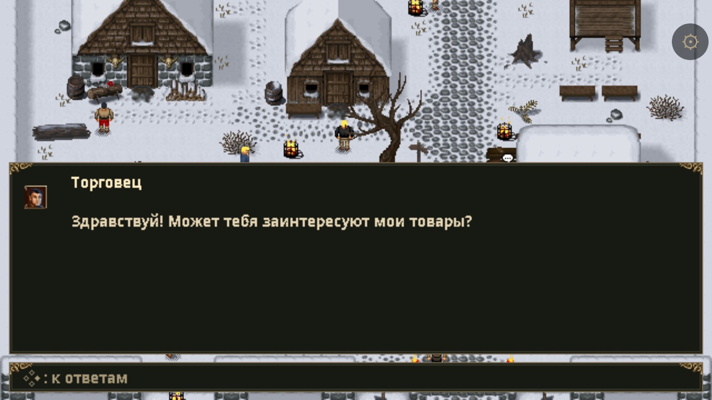
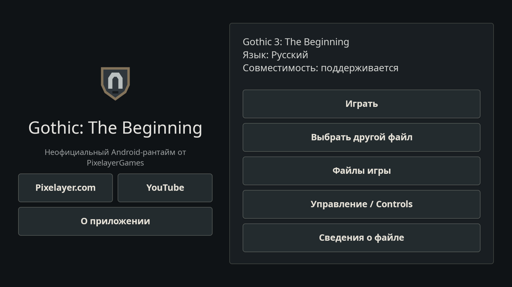
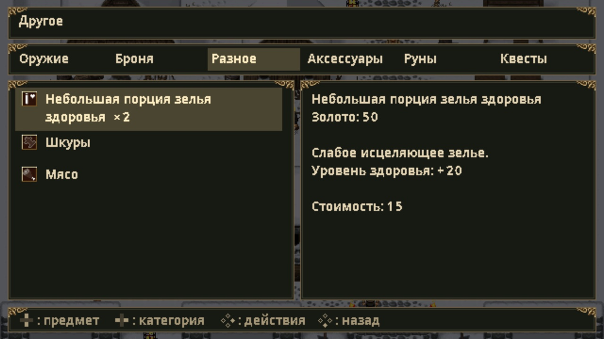
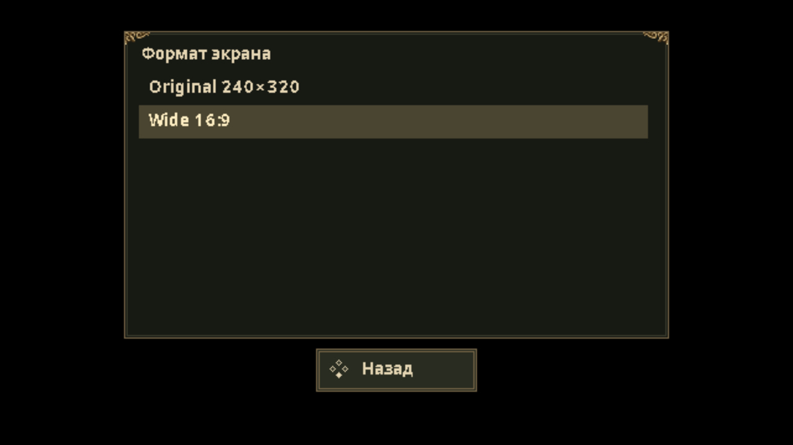
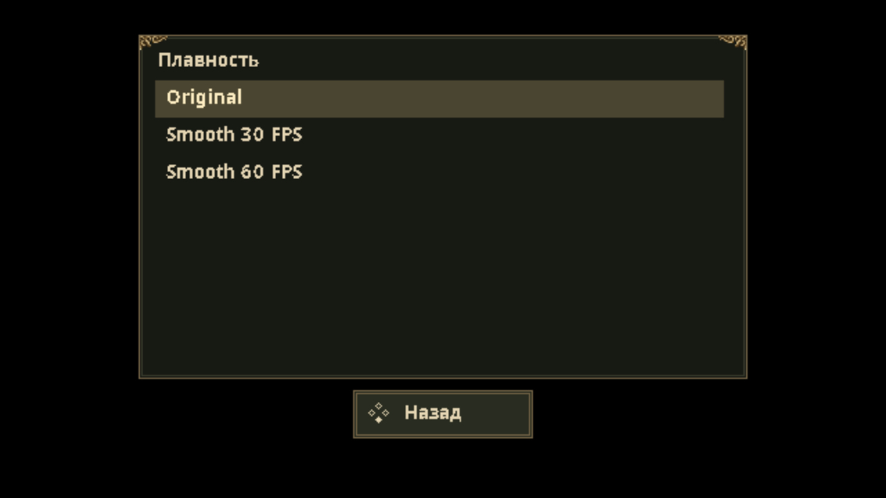

# Gothic: The Beginning

**English** · [Русский](README.ru.md) · [Pixelayer](https://pixelayer.com/) · [YouTube](https://www.youtube.com/@pixelayergames)

Play the original mobile **Gothic 3: The Beginning** on Android with widescreen, a gamepad or touch controls. You’ll need your own copy of the supported game JAR.

**Unofficial project by PixelayerGames** · **Beta 0.1.0-beta.2** · **Android 8 (API 26) or later**

## [Download APK](https://github.com/PixelayerGames/gothic-the-beginning-android/releases/download/v0.1.0-beta.2/gothic-the-beginning-android-0.1.0-beta.2.apk)

[Release notes](https://github.com/PixelayerGames/gothic-the-beginning-android/releases/tag/v0.1.0-beta.2) · [SHA256SUMS.txt](https://github.com/PixelayerGames/gothic-the-beginning-android/releases/download/v0.1.0-beta.2/SHA256SUMS.txt)

## Quick Start

1. Download the signed APK from Releases.
2. Install the APK on your Android device.
3. Copy the JAR from your own lawfully obtained copy of **Gothic 3: The Beginning** to your device. Check which edition you need in [JAR compatibility](#which-jar-do-i-need).
4. Open the app, tap **Choose game (Выбрать игру)** and select the JAR.
5. Wait for **Совместимость: поддерживается** (supported).
6. Tap **Play (Играть)**.

The installed app processes your JAR locally. When you tap **Play**, it converts the game code into Android bytecode (DEX) and runs it on your device within the installed app.

## Screenshots

Captured on Retroid Pocket 5.

| Khorinis in Wide 16:9 | Talking to a merchant |
| --- | --- |
|  |  |
| **Start screen** | **Inventory** |
|  |  |
| **Screen format** | **Frame-rate options** |
|  |  |

## Which JAR do I need?

> [!IMPORTANT]
> Game launch is limited to the exact Russian J2ME 1.0 edition (B03) listed below. The optional English edition (B01) supplies text for that game.

| Edition | Exact size | Use |
| --- | ---: | --- |
| Russian J2ME 1.0 (B03) | 395,053 bytes | Required to play. Includes the Russian game text. |
| English J2ME 1.0 (B01) | 326,413 bytes | Optional. Supplies English text after you import the Russian game. |

Exact SHA-256 checksums and file markers

| Edition | SHA-256 | Inside the JAR |
| --- | --- | --- |
| B03 | `d69f5a6dfb23bd1e81354f975a45e4cf16ca46b0262bb799c807920f60c30dae` | `RU.MAIN.lng` file. Manifest declares `CLDC-1.1`. |
| B01 | `284d5a5c13f0707527b33a62f9cb9147c0ec7ab6df2c74431efd899a7b7d33ff` | `EN.MAIN.lng` file. Manifest declares `CLDC-1.0`. |

If the app reports an unsupported JAR, check the exact size and SHA-256 of your `.jar` file. File names vary. If the file is reported as damaged, copy it again from your own original. If its SHA-256 matches and the app still rejects it, [report a bug](#report-a-bug).

## Features

- **Display.** Original 240×320 and Wide 16:9, with menus, dialogue and inventory laid out for widescreen.
- **Motion.** Original, Smooth 30 FPS and Smooth 60 FPS. Smooth modes interpolate movement for smoother display while keeping the original game simulation speed.
- **Controls.** Physical gamepad and on-screen controls. Adjust the size, opacity and layout of the on-screen buttons.
- **Game language.** Russian with B03, plus English with the optional B01 text import.
- **Saves.** Save and load through the in-game menu. Saves and settings are stored on the device.

Gamepad and touch input were tested on Retroid Pocket 5 (Android 13). On the same model, beta.2 was tested from JAR import through the opening and arrival in Khorinis in Wide mode. English in Wide mode was checked in the Android emulator.

## Known limitations

- **Campaign coverage.** The opening and selected gameplay scenarios were tested. A full playthrough remains unverified, and interface or gameplay bugs may still be present.
- **Compatibility.** Game launch requires the exact Russian JAR listed above. Android 8 is the minimum requirement, and testing covers a limited set of devices and controllers. Smooth modes target the selected frame rate, and actual performance varies by device and scene.
- **English.** English applies to in-game text after a restart. The import screen remains in Russian.
- **Save files.** Saves are stored in this app. This beta has no save import or export feature.
- **Audio.** In one emulator test, the main-menu music stayed silent after returning to the same menu from the background. Behavior on other devices remains unverified.

## FAQ

Where do I download the APK?

Get the signed APK and its checksum from [Releases](https://github.com/PixelayerGames/gothic-the-beginning-android/releases).

Why does the app ask for a JAR?

The APK provides the Android runtime. Your original JAR supplies the game code, graphics and other game data.

Can I use any edition of Gothic?

Use the exact Russian J2ME 1.0 edition (B03) shown under [JAR compatibility](#which-jar-do-i-need). The English B01 is an optional source of text for B03.

Do I need internet access?

You need a connection to download the APK from GitHub. Once the APK and JAR are available on your device, import and play work offline.

Does it work with a gamepad?

The beta supports gamepad and touch input. Both were tested on Retroid Pocket 5.

How do I switch to English?

First import B03. From the app’s start screen, open **Game files (Файлы игры)**, choose **Add English language (Добавить английский язык)** and select your B01 JAR. Choose **English** under **Language (Язык)** in the game settings, choose **Apply on next launch (Применить при запуске)** and restart the game. Your saves stay available.

How do I update and keep my saves?

Save in-game, close the app and install the newer signed APK over the existing installation. Android keeps local data when the package and signing key match. Uninstalling deletes local saves and settings.

What if my JAR is unsupported?

Compare the exact size and SHA-256 under [JAR compatibility](#which-jar-do-i-need). If a supported file is rejected, [report the error](#report-a-bug) and include the checksum.

Why is the original game absent from the repository?

This repository distributes the Android runtime. The rights to the original game and its materials belong to their respective holders. The app uses files from your own lawfully obtained copy.

Can I report a bug?

Yes. Follow the steps in [Report a bug](#report-a-bug).

## Report a bug

[File an issue](https://github.com/PixelayerGames/gothic-the-beginning-android/issues/new/choose) with the APK version, device model, Android version, JAR edition or SHA-256, steps to reproduce, and what you expected versus what happened. A screenshot helps when relevant. **Please keep original game JAR files out of public issues.**

## Project and licenses

This is an independent, unofficial project by PixelayerGames. Gothic and the original game materials belong to their respective rights holders. The release contains the Android runtime. The app’s source code is currently unpublished. [Third-party notices and licenses](THIRD_PARTY_NOTICES.txt) cover the bundled third-party components.
