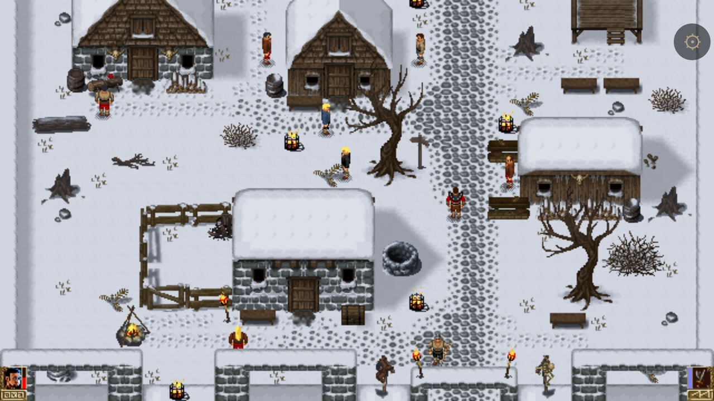

# Gothic: The Beginning

**English** · [Русский](README.ru.md)

An unofficial Android runtime for the mobile **Gothic 3: The Beginning**, made by PixelayerGames. Play a compatible copy of the original game in its 240 × 320 layout or in widescreen 16:9, with a gamepad or touch controls.

[Download the Android APK](https://github.com/PixelayerGames/gothic-the-beginning-android/releases) · [Pixelayer website](https://pixelayer.com/) · [YouTube](https://www.youtube.com/@pixelayergames)

## Screenshots

Captured on Retroid Pocket 5.

| Khorinis in Wide 16:9 | Talking to a merchant |
| --- | --- |
|  |  |
| **Start screen** | **Inventory** |
|  |  |
| **Screen format** | **Frame-rate options** |
|  |  |

## Which JAR do I need?

Install the signed APK from **Releases** on Android 8 (API 26) or later. Use the `.jar` from your own legitimately obtained copy of **Gothic 3: The Beginning**. The supported game file is the **Russian version 1.0 for Java phones (J2ME)**. It is **395,053 bytes** (about **386 KiB**). The filename may vary.

1. Copy your `.jar` to Android, for example to **Downloads**.
2. Open the app, tap **Choose game (Выбрать игру)** and select the file.
3. When you see **Совместимость: поддерживается** (supported), tap **Play (Играть)**.

## Playing in English

If you also have the **English J2ME version 1.0 JAR** of **326,413 bytes**, import its text under **Game files (Файлы игры)**. Select English in the in-game settings and restart the game. The game runs from the Russian JAR.

Exact file sizes and SHA-256 checksums

| Use | Size | SHA-256 |
| --- | ---: | --- |
| Russian 1.0 game (B03) | 395,053 bytes | `d69f5a6dfb23bd1e81354f975a45e4cf16ca46b0262bb799c807920f60c30dae` |
| English 1.0 text (B01) | 326,413 bytes | `284d5a5c13f0707527b33a62f9cb9147c0ec7ab6df2c74431efd899a7b7d33ff` |

If you inspect the archive, the game JAR contains `RU.MAIN.lng` and declares `CLDC-1.1` in its manifest. The English JAR contains `EN.MAIN.lng` and declares `CLDC-1.0`. The SHA-256 identifies the exact supported file.

## Display modes

Choose Original or Wide 16:9 in the game's settings. The Original, Smooth 30 and Smooth 60 presentation modes keep the original simulation speed.

## Updates and saves

Save your progress in the game, close it, then install the newer signed APK over the existing **Gothic: The Beginning** installation. Android keeps saves and settings for updates to the same package. Uninstalling deletes this application's local data. The release page includes a SHA-256 checksum for each APK.

## About

Game files are processed locally. The website and YouTube buttons open in another app. This beta has been tested through the opening and in selected gameplay scenarios. In **Issues**, report the app version, Android version and steps to reproduce.

An independent project by PixelayerGames. Gothic and the original game materials belong to their respective rights holders. [Third-party notices and licenses](THIRD_PARTY_NOTICES.txt).
