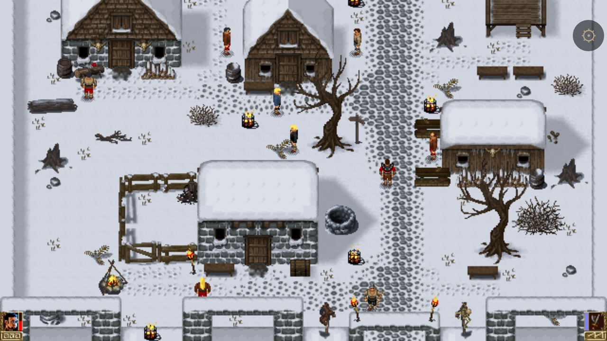
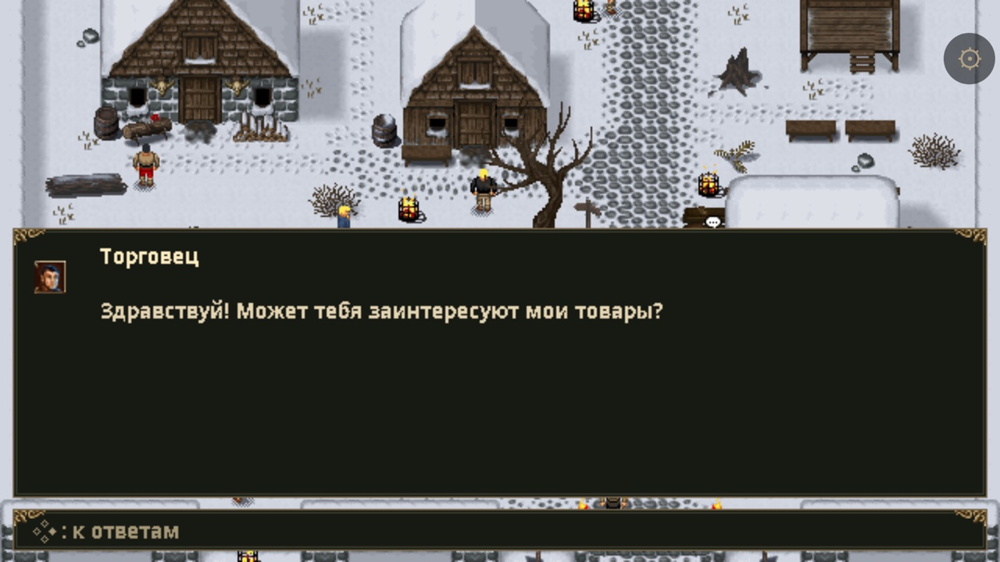
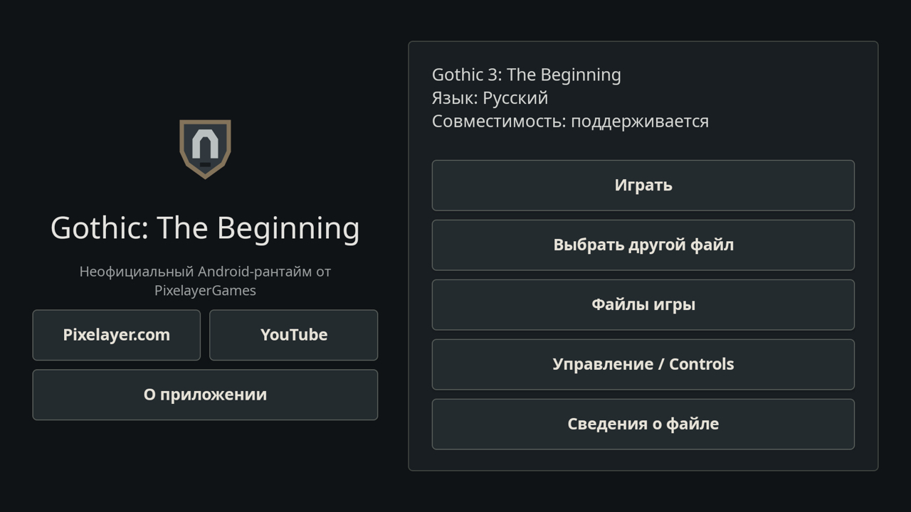
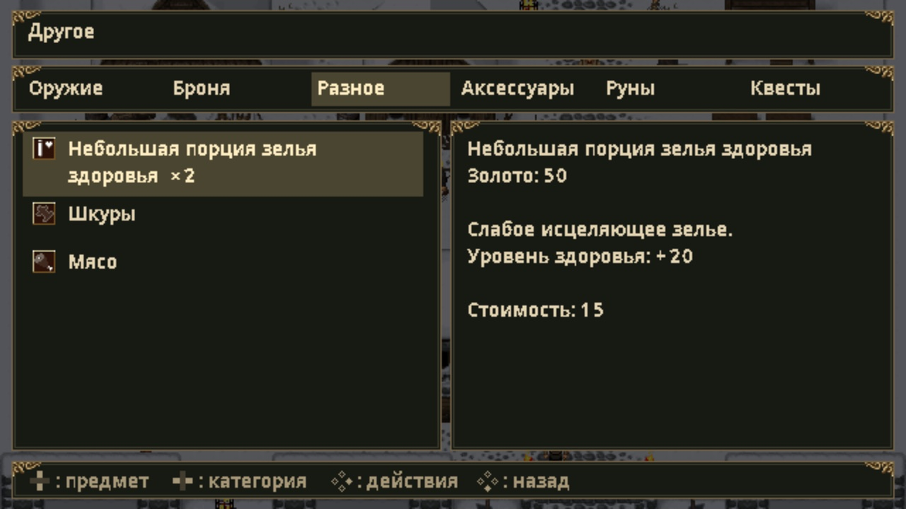
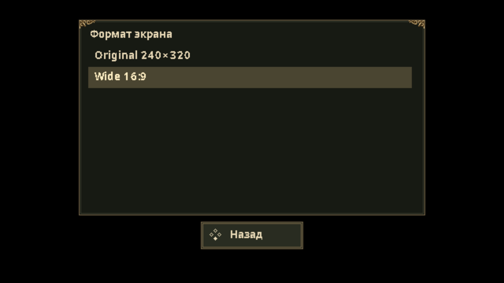
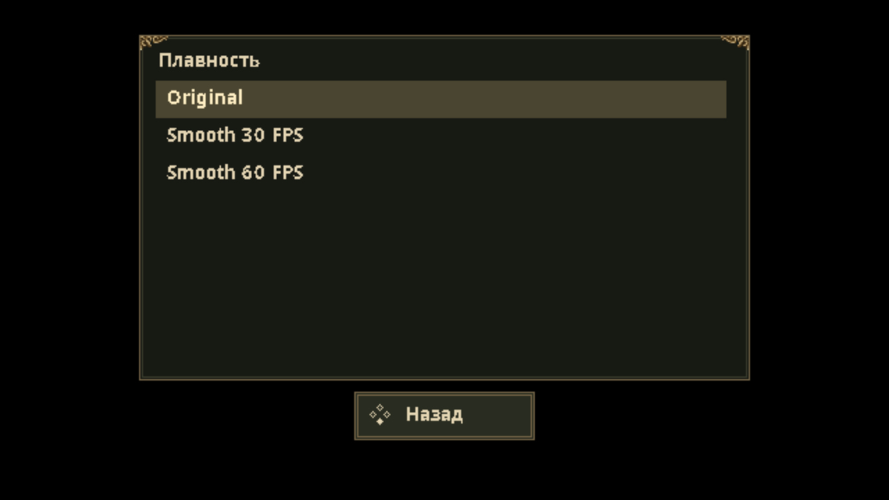

# Gothic: The Beginning

[English](README.md) · **Русский** · [Pixelayer](https://pixelayer.com/) · [YouTube](https://www.youtube.com/@pixelayergames)

Оригинальная мобильная **Gothic 3: The Beginning** на Android с широким экраном, геймпадом и сенсорным управлением. Для запуска понадобится собственная копия поддерживаемого JAR.

**Неофициальный проект PixelayerGames** · **Бета 0.1.0-beta.2** · **Android 8 (API 26) или новее**

## [Скачать APK](https://github.com/PixelayerGames/gothic-the-beginning-android/releases/download/v0.1.0-beta.2/gothic-the-beginning-android-0.1.0-beta.2.apk)

[Описание релиза](https://github.com/PixelayerGames/gothic-the-beginning-android/releases/tag/v0.1.0-beta.2) · [SHA256SUMS.txt](https://github.com/PixelayerGames/gothic-the-beginning-android/releases/download/v0.1.0-beta.2/SHA256SUMS.txt)

## Быстрый старт

1. Скачайте подписанный APK из раздела Releases.
2. Установите APK на устройство Android.
3. Скопируйте на устройство JAR из своей законно полученной копии **Gothic 3: The Beginning**. Сверьте версию в разделе [Какой JAR нужен](#какой-jar-нужен).
4. Откройте приложение, нажмите **«Выбрать игру»** и укажите JAR.
5. Дождитесь сообщения **«Совместимость: поддерживается»**.
6. Нажмите **«Играть»**.

Установленное приложение обрабатывает JAR локально. По кнопке **«Играть»** оно преобразует игровой код в байткод Android (DEX) и запускает его на устройстве внутри приложения.

## Скриншоты

Снято на Retroid Pocket 5.

| Хоринис в Wide 16:9 | Разговор с торговцем |
| --- | --- |
|  |  |
| **Стартовый экран** | **Инвентарь** |
|  |  |
| **Формат экрана** | **Частота кадров** |
|  |  |

## Какой JAR нужен

> [!IMPORTANT]
> Для запуска подходит только указанная ниже русская J2ME-версия 1.0 (B03). Английская версия (B01) используется для импорта текста в эту же игру.

| Версия | Точный размер | Назначение |
| --- | ---: | --- |
| Русская J2ME 1.0 (B03) | 395 053 байта | Обязательна для запуска. Содержит русский текст игры. |
| Английская J2ME 1.0 (B01) | 326 413 байт | Необязательна. Добавляет английский текст после импорта русской игры. |

Точные контрольные суммы SHA-256 и признаки файлов

| Версия | SHA-256 | Что внутри JAR |
| --- | --- | --- |
| B03 | `d69f5a6dfb23bd1e81354f975a45e4cf16ca46b0262bb799c807920f60c30dae` | Файл `RU.MAIN.lng`. В манифесте указан `CLDC-1.1`. |
| B01 | `284d5a5c13f0707527b33a62f9cb9147c0ec7ab6df2c74431efd899a7b7d33ff` | Файл `EN.MAIN.lng`. В манифесте указан `CLDC-1.0`. |

Если приложение сообщает о неподдерживаемом JAR, сверьте точный размер и SHA-256 файла `.jar`. Имя файла может отличаться. Если приложение сообщает, что файл повреждён, заново скопируйте его из своей оригинальной копии. Если контрольная сумма совпадает, а приложение отклоняет файл, [сообщите об ошибке](#сообщить-об-ошибке).

## Возможности

- **Экран.** Original 240×320 и Wide 16:9. В широком режиме есть отдельная раскладка меню, диалогов и инвентаря.
- **Плавность.** Original, Smooth 30 FPS и Smooth 60 FPS. В режимах Smooth движение отображается плавнее за счёт промежуточных кадров. Скорость игровой симуляции сохраняется.
- **Управление.** Физический геймпад и кнопки на экране. Можно настроить размер, прозрачность и расположение экранных кнопок.
- **Язык игры.** Русский из B03. Для английского можно отдельно импортировать текст из B01.
- **Сохранения.** Запись и загрузка через игровое меню. Сохранения и настройки хранятся на устройстве.

На Retroid Pocket 5 с Android 13 проверены геймпад и сенсорное управление. На той же модели в beta.2 проверены импорт JAR, запуск и начало игры до Хориниса в Wide. Английский текст в широком режиме проверен в эмуляторе Android.

## Известные ограничения

- **Кампания.** Проверены начало игры и отдельные игровые сценарии. Полное прохождение пока не подтверждено. Возможны ошибки интерфейса или игрового процесса.
- **Совместимость.** Для запуска нужен точный русский JAR из таблицы выше. Минимальная версия — Android 8. Проверки охватывают ограниченный набор устройств и контроллеров. В режимах Smooth указана целевая частота кадров. Фактическая зависит от устройства и сцены.
- **Английский язык.** Применяется к тексту игры после перезапуска. Экран импорта остаётся на русском.
- **Файлы сохранений.** Сохранения хранятся внутри приложения. Импорт и экспорт сохранений в этой бете недоступны.
- **Звук.** В одном тесте в эмуляторе музыка главного меню не возобновилась после возврата из фона в то же меню. Поведение на других устройствах пока не подтверждено.

## FAQ

Где скачать APK?

Подписанный APK и его контрольная сумма доступны в [Releases](https://github.com/PixelayerGames/gothic-the-beginning-android/releases).

Почему приложение просит JAR?

APK содержит оболочку для Android. Оригинальный JAR предоставляет игровой код, графику и данные игры.

Можно ли использовать любую версию Gothic?

Для запуска нужна точная русская J2ME-версия 1.0 (B03) из раздела [Какой JAR нужен](#какой-jar-нужен). Английский B01 можно использовать как источник текста для B03.

Нужен ли интернет?

Подключение нужно для загрузки APK с GitHub. Когда APK и JAR уже на устройстве, импорт и игра работают без интернета.

Работает ли приложение с геймпадом?

Бета поддерживает геймпад и сенсорное управление. Оба варианта проверены на Retroid Pocket 5.

Как включить английский язык?

Сначала импортируйте B03. На стартовом экране откройте **«Файлы игры»** → **«Добавить английский язык»** и выберите JAR B01. В настройках игры откройте **«Язык»**, выберите **English**, нажмите **«Применить при запуске»** и перезапустите игру. Сохранения останутся доступны.

Как обновить приложение и сохранить прогресс?

Сохранитесь в игре, закройте приложение и установите новый подписанный APK поверх текущей установки. Android сохраняет данные при совпадении пакета и ключа подписи. При удалении приложения локальные сохранения и настройки удаляются.

Что делать, если JAR не подходит?

Сверьте размер и SHA-256 в разделе [Какой JAR нужен](#какой-jar-нужен). Если поддерживаемый файл отклонён, [сообщите об ошибке](#сообщить-об-ошибке) и укажите контрольную сумму.

Почему в репозитории нет оригинальной игры?

Через репозиторий распространяется Android-оболочка. Права на оригинальную игру и её материалы принадлежат соответствующим правообладателям. Для запуска используется ваша законно полученная копия игры.

Можно ли сообщить об ошибке?

Да. Соберите сведения по инструкции в разделе [Сообщить об ошибке](#сообщить-об-ошибке).

## Сообщить об ошибке

[Создайте Issue](https://github.com/PixelayerGames/gothic-the-beginning-android/issues/new/choose) и укажите версию APK, модель устройства, версию Android, версию или SHA-256 JAR, шаги воспроизведения, ожидаемое и фактическое поведение. Если скриншот помогает понять проблему, приложите его. **Не прикладывайте оригинальные JAR игры к публичным сообщениям.**

## Проект и лицензии

Это независимый неофициальный проект PixelayerGames. Права на Gothic и оригинальные материалы игры принадлежат соответствующим правообладателям. В релиз входит Android-оболочка. Исходный код самого приложения пока не опубликован. [Уведомления и лицензии сторонних компонентов](THIRD_PARTY_NOTICES.txt) относятся к включённым сторонним компонентам.
